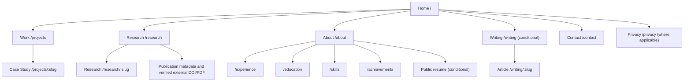

# Phase 02.4 — Information Architecture & Navigation

**Status:** SEVEN IA DECISIONS APPROVED — REQUIREMENTS CROSSWALK PENDING (see ADR-IA-001)
**Updated:** 2026-10-23
**Repository:** tamjidniloy/portfolio-platform
**Visual baseline:** ADR-UI-001 (approved). Brand and exact fonts remain open.
**Requirements:** Based on Phase 01 draft page inventory and Phase 02.3 journeys. Authoritative approved SRS is not yet verified on GitHub; see `docs/phase01/SRS_RECONCILIATION.md`.

## 1. Purpose and success criteria
Create a findable, predictable and accessible navigation model for worldwide visitors (recruiters, engineers, AI/ML collaborators) and the sole portfolio administrator. Each screen has a meaningful route or intentional inline state. The architecture must handle incomplete real-world content without fabrication.

Key UX outcomes:
- Homepage shows identity + obvious routes to work, research and contact.
- A project or research item can be linked using a stable public permalink.
- Resume, formal publications, demos and social links are shown only when real and approved for display.
- Admin access uses the same application origin but a separate protected route group.
- The navigation can be updated through approved CMS settings without exposing arbitrary unsafe routes.
- Drafts never leak through public links, SSR HTML, APIs or sitemap.

## 2. Top-level information model
1. **Identity:** Home, About, Career, Education, Skills, Social, Resume.
2. **Engineering evidence:** Projects, technical case studies, code/demo links.
3. **Research evidence:** Research entries, study statuses, publications, datasets and references.
4. **Professional content:** Writing, Achievements, Certifications, Open Source.
5. **Conversion:** Contact and collaboration.
6. **Operations:** Admin authentication, editing, publishing, assets, settings and messages.

### Content taxonomy (proposed, subject to SRS)
- Project categories: full-stack, frontend, backend, AI-integrated, tooling/automation, other. Do not force all items into a single category; taxonomy should reflect real content.
- Research stage: idea / ongoing / completed / published (separate from CMS draft/published/archived state).
- Writing categories: engineering, AI/ML, research notes, tutorials, other (only show populated groups).
- Skills: languages, frontend, backend, database, ML/data, infrastructure, tools.

## 3. Primary navigation
**Desktop:** logo/public brand (-> /); Work (-> /projects); Research (-> /research); About (-> /about); conditional Writing (-> /writing); Contact CTA (-> /contact).
**Mobile:** compact header, menu disclosure/drawer; same semantic order; Contact reachable without deep nesting.
**Secondary:** Experience, Education, Skills, Achievements accessible through About sections and footer; public Resume link only when enabled. Publication list is a region of Research in Release 1, not a separate compulsory public route. Publication individual links use validated external paper/DOI when available or related research detail. Avoid making a blank /publications page.
**Breadcrumbs:** Detail pages show Home → Projects/Research/Writing → current item. About subpages show Home → About → current topic.
**Footer:** grouped Work / Research / About / Contact plus approved social links, optional public resume and privacy/legal links when relevant. Do not duplicate every deep link unconditionally.
**Active navigation:** Work stays active on project detail; Research stays active on research detail; Writing on article detail; About on background subpages. Contact only active on contact. Logo always returns Home.

## 4. Public sitemap

## 5. Public route inventory
| Screen ID | URL | Template | Discovery | Missing/unpublished behavior |
|---|---|---|---|---|
| PUB-01 | `/` | Landing | Main | Show sections conditionally; page must exist |
| PUB-02 | `/about` | Editorial profile | Primary | Keep page, hide missing subsections |
| PUB-03 | `/projects` | Directory | Primary: Work | Friendly empty state; hide featured links if none |
| PUB-04 | `/projects/:slug` | Case study | Contextual | Missing/draft => 404; old slug => redirect only to published new URL |
| PUB-05 | `/research` | Research directory | Primary | No fabricated studies; empty state |
| PUB-06 | `/research/:slug` | Research detail | Contextual | Missing/draft => 404; no paper CTA if absent |
| PUB-07 | `/experience` | Timeline | About + footer | Omit navigation to section when empty |
| PUB-08 | `/education` | Academic list | About + footer | Omit navigation to section when empty |
| PUB-09 | `/skills` | Categorized list | About + footer | No fabricated proficiency ratings |
| PUB-10 | `/achievements` | Credential list | About + footer | Unverified claims not marked verified |
| PUB-11 | `/writing` | Editorial directory | Conditional primary | Hide from primary when no articles |
| PUB-12 | `/writing/:slug` | Long-form reading | Contextual | Missing/draft => 404; old slug redirect if published |
| PUB-13 | `/contact` | Form | Primary CTA | Inline success/error; preserve typed input on failure |
| PUB-14 | `/privacy` | Legal text | Footer if required | Publish policy before any relevant collection requiring disclosure |
| PUB-15 | `/404 (response)` | Error | Utility | Return true HTTP 404; do not expose drafts |
| PUB-16 | `/assets/resume/...` | Document | About + footer when enabled | Hide CTA if no public PDF; never expose private files |

See `04_SCREEN_INVENTORY.md` for content, CTA, state and prototype-board details.

## 6. Homepage section architecture
1. Header + skip-to-main.
2. Hero: actual identity, role, concise value statement; Explore Work and contextual Research/Contact CTA.
3. Selected published projects (hide when none).
4. Selected published research/experiments (hide when none).
5. Technical expertise snapshot linking to Skills/related proof.
6. Background summary linking to About/Experience/Education where content exists.
7. Optional verified achievements / published articles.
8. Contact CTA.
9. Footer.

CMS ordering may rearrange approved section identifiers, but cannot introduce unsanitized arbitrary JSX/HTML. Hero and meaningful contact route remain discoverable.

## 7. Page-level navigation and relationships
- Project cards → specific case study → related skills, verifiable repository/demo, other published projects.
- Research cards → research detail → related verified publication metadata, paper/code/dataset links, contact.
- Skill → relevant published projects/research (optional relationship, no fabricated mastery percentages).
- Article → relevant projects/research where explicitly linked.
- About → experience/education/skills/achievements; resume only if published; contact CTA.
- No circular dead ends: every detail has breadcrumb, collection return and footer.

## 8. Public states, statuses and SEO
- Missing/unpublished **detail**: respond HTTP 404; do not expose metadata of a draft or permit direct API retrieval.
- Slug rename: redirect old public slug to current published canonical slug; avoid redirect to unpublished destinations.
- Empty **collection**: approved collection URL may display a friendly empty state; hide from primary navigation and consider noindex until useful published content exists (policy needs sign-off).
- Required global pages (Home, About, Contact): remain accessible with truthful placeholders/empty states as appropriate.
- Contact successful submission: show inline confirmation (avoid shareable fake success URL); error preserves form inputs; never claim email delivery unless known.
- Protected previews: noindex, no-store, require server-side authorization.
- Sitemap: only indexable canonical public URLs (and actual published detail records); no /admin routes, draft previews, token/reset URLs or public APIs.
- Metadata, language, canonical and OG assets will be defined in later SEO implementation; final public brand pending.

## 9. Admin route organization
- Anonymous/challenge-only authentication screens are exceptions within /admin/*.
- Every other /admin route requires an active server-authorized session. Frontend route hiding is not access control.
- Admin left navigation groups: Overview; Content (Profile, Projects, Research, Publications, Writing); Background (Experience, Education, Skills, Achievements, Open Source); Assets (Media, Resume); Communication (Messages); Configuration (Site Settings, SEO, Security).
- Admin list → New/Edit → Save Draft → authorized Preview → Publish → verify public permalink.
- Mobile admin navigation uses accessible drawer with active section and persistent access to Save/Publish actions.
- Sensitive pages avoid public caching and indexing; recovery tokens never placed in analytics events.

## 10. Full admin route inventory
| Screen ID | URL | Access | Nav group | Screen purpose |
|---|---|---|---|---|
| ADM-01 | `/admin/login` | Anonymous | Authentication | Email/password entry; generic failure, rate limits |
| ADM-02 | `/admin/verify` | Active challenge only | Authentication | One-time email challenge; expiry, resend and attempt limits |
| ADM-03 | `/admin/forgot-password` | Anonymous | Authentication | Neutral reset request form; no account enumeration |
| ADM-04 | `/admin/reset-password` | Valid token | Authentication | Set new password, token validity/error, return to login |
| ADM-05 | `/admin` | Admin | Overview | Dashboard, recent activity and content summaries |
| ADM-06 | `/admin/profile` | Admin | Content | Edit identity, hero, about, professional links and visibility |
| ADM-07 | `/admin/projects` | Admin | Content | Project list, status, filters, create link |
| ADM-08 | `/admin/projects/new` | Admin | Content | Project editor: save draft, validation, media |
| ADM-09 | `/admin/projects/:id/edit` | Admin | Content | Project editor, private preview, publish, revision access |
| ADM-10 | `/admin/research` | Admin | Content | Research list and linked publications |
| ADM-11 | `/admin/research/new` | Admin | Content | Research editor with separate research/publication status |
| ADM-12 | `/admin/research/:id/edit` | Admin | Content | Edit, preview, publish or unpublish research |
| ADM-13 | `/admin/publications` | Admin | Content | Publication list; relationships to research records |
| ADM-14 | `/admin/writing` | Admin | Content | Published/draft article index |
| ADM-15 | `/admin/writing/new` | Admin | Content | Rich-text article editor |
| ADM-16 | `/admin/writing/:id/edit` | Admin | Content | Article edit, revisions and publishing |
| ADM-17 | `/admin/experience` | Admin | Background | Experience records |
| ADM-18 | `/admin/education` | Admin | Background | Education records |
| ADM-19 | `/admin/skills` | Admin | Background | Skills and controlled categories |
| ADM-20 | `/admin/achievements` | Admin | Background | Awards/certificates; verifiable credentials |
| ADM-21 | `/admin/open-source` | Admin | Background | Open-source contributions |
| ADM-22 | `/admin/media` | Admin | Assets | Media library, upload, alt text and reference safety |
| ADM-23 | `/admin/resume` | Admin | Assets | Validate, replace and publish PDF |
| ADM-24 | `/admin/messages` | Admin | Communication | Private inbox, filters and retention controls |
| ADM-25 | `/admin/messages/:id` | Admin | Communication | Message view with privacy-aware actions |
| ADM-26 | `/admin/settings` | Admin | Settings | Navigation, hero, appearance and footer configuration |
| ADM-27 | `/admin/settings/seo` | Admin | Settings | Meta title, descriptions, preview image and canonical controls |
| ADM-28 | `/admin/security` | Admin | Account | Password, sessions, email ownership and recovery |
| ADM-29 | `/admin/preview/:type/:id` | Admin | Preview | Authorized preview, unpublished content, noindex/no-store |
| ADM-30 | `/admin/:unknown` | Admin | Utility | Protected not-found page, with dashboard return |

Note: screen names are design proposals; actual route/implementation selection is Phase 03–04. Not all CRUD methods require distinct screens (e.g. simple skill editor may open a dialog).

## 11. Data visibility and publication contract
- CMS content publication status: draft | published | archived.
- Research scientific status is distinct from CMS publication status.
- Public requests must query only published records and owner-approved fields.
- Private previews are authenticated only and never indexed; disabling menu items does not unlock a private URL.
- No external repo/demo/paper link when unknown or intentionally hidden.
- Public contact exposure follows owner privacy settings.

## 12. Navigation accessibility and responsiveness
- Semantic landmark roles for header, nav, main and footer; skip link; one H1 per page.
- Keyboard-operable desktop/mobile menus, visible focus, Escape to close, focus return.
- Current page indicated programmatically; drawers block background interaction only while open.
- Long project titles and article headings wrap without horizontal overflow.
- Main nav at 320px must remain usable with compact menu; no horizontal overflow.
- Respect reduced motion and avoid unrequested scroll hijacking.
- Responsive admin retains access to current breadcrumb and primary form actions.

## 13. Journey crosswalk
| Journey | Key screens/routes |
|---|---|
| J-01 | PUB-01 → PUB-02/PUB-03/PUB-05 → PUB-13 |
| J-02 | PUB-01 → PUB-03 → PUB-04 → PUB-07/PUB-16 → PUB-13 |
| J-03 | PUB-03 → PUB-04 → verified external demo/code |
| J-04 | PUB-05 → PUB-06 → publication/reference or PUB-13 |
| J-05 | PUB-13 → inline success/error |
| J-06 | ADM-01 → ADM-02 → ADM-05 |
| J-07 | ADM-03 → ADM-04 → ADM-01 |
| J-08 | ADM-05 → ADM-07 → ADM-08/ADM-09 → ADM-29 → publish → PUB-04 |
| J-09 | ADM-07 → ADM-09 → revisions / unpublish / restore |
| J-10 | ADM-22 → selected editor → preview |
| J-11 | ADM-10 → ADM-11/ADM-12 → ADM-29 → PUB-06 |
| J-12 | ADM-24 → ADM-25 |
| J-13 | All pages → keyboard/mobile review |
| J-14 | Sitemap → published PUB routes only |

## 14. Open design decisions
- IA-D01: Confirm whether Writing may appear in primary nav only when published; default yes.
- IA-D02: Confirm whether optional empty collection URLs show noindex empty state vs temporary 404; proposal noindex empty collection.
- IA-D03: Confirm whether Research itself groups publications vs separate public route; proposed research grouping.
- IA-D04: Confirm whether About subpages are separate routes plus links; proposed yes.
- IA-D05: Confirm user-editable nav limited to safe predefined route IDs; proposed yes.
- IA-D06: Approved Phase 01 SRS on GitHub still missing; route and requirement IDs must be reconciled before final sign-off.
- IA-D07: Public brand/name, exact fonts and final CTA wording remain open.

## 15. Handoff criteria for Phase 02.5
Owner approves routes and primary/secondary nav; screen inventory complete; journey map covers pages; draft/404/preview status rules accepted; Penpot sitemap reviewed; SRS reconciled or explicitly marked outstanding (cannot finalize Phase 02 sign-off).
