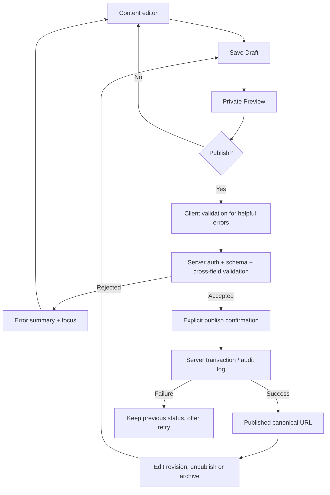

# Phase 02.8 — CMS Validation & Publishing Interaction Contract

**Status:** UX INTERACTION DESIGN APPROVED SUBJECT TO SRS RECONCILIATION (ADR-UX-002); not implemented or a final server/API contract
**Parent approval:** ADR-WF-003 approves the admin wireframe direction.
**Outstanding:** Approved Phase 01 SRS is absent from GitHub main. Historical draft constraints must be reconciled before Phase 03 schema/API commitments.

## User-facing states
| State | Public visible? | UX actions | Feedback |
|---|---|---|---|
| New/unsaved | No | Edit fields, Save Draft, Cancel | Unsaved changes notice |
| Saving | No | Prevent duplicate save, allow cancel where safe | Saving progress/disabled unsafe actions |
| Draft saved | No | Edit, Preview, Publish if complete | Authoritative saved confirmation |
| Private preview | No | Back to editor, review actual rendering | Authenticated, noindex, no-store |
| Publish invalid | No change | Fix highlighted fields, retry | Error summary and field errors |
| Publishing | No newly published state until confirmed | Confirm/cancel before submit | Clear progress, prevent double submit |
| Published | Yes (published fields only) | Open public URL, edit revision, unpublish | Canonical URL + server-confirmed status |
| Revision draft | Existing approved version stays live (PROPOSED) | Edit, preview new revision | Explicit "Live vs Unpublished changes" indicators |
| Archived/unpublished | No | Restore to draft / inspect history | Public list/sitemap/direct URL removed |
| Save conflict | No blind overwrite | Reload comparison, copy draft, retry safely | Conflict explanation and preserved local edits |
| Session expired | Protected editor hidden | Reauthenticate, restore safe local form state if policy allows | No cached admin data leaked |
| Upload rejected | No attachment | Correct file, retry | Type/size/server error, original form preserved |

## Flowchart

## Client / server validation division
- Browser: labels, length previews, required-on-publish indicators, date constraints, URL format hints, upload preview and accessible error feedback.
- Server: authoritative Zod (or equivalent validated schema) checks, owner/session authorization, CSRF protection as needed, rate limiting, uniqueness, file content verification, slug collisions, safe rich text, database referential checks, allowed navigation IDs, state transition and transaction consistency.
- Never rely on client-side disabled inputs or hidden routes for access control.
- Form values with secrets must not appear in URLs, Redux caches, analytics, toasts, or client telemetry.

## Cross-field examples
- Project: unique normalized slug; date end >= start; referenced skills and media exist; published featured project references published record.
- Research: scientific `research_status` independent of CMS `status`; only genuine results/publication links; optional related published publication reference. If study still ongoing, preserve truthful labels and remove fake acceptance cues.
- Experience/Education: `is_current` must agree with end date; date order valid; avoid revealing optional private grade/location without consent.
- Publication: at least one authentic author and valid DOI/arXiv if provided; do not infer journal acceptance from preprint.
- Article: meaningful body, valid internal references, safe media; no scripts or unsafe HTML in public renderer.
- Media: real file type/signature, supported size, safe alt text, ownership; referenced published asset cannot be silently deleted.
- Site navigation: only whitelisted route IDs can be saved; do not create arbitrary redirects to internal admin URLs.
- SEO: canonical values constrained to approved public domains and routes; never index drafts, admin, password recovery or private previews.
- Contact inbox: messages can be read/archived/deleted per retention policy; body and sender should remain untouched.
- Resume: PDF must be validated before public promotion, unpublished copies inaccessible to visitors.

## Error / edge path designs
1. Invalid save-draft data type: inline error without deleting entered data.
2. Publish button with missing public fields: error summary at top, autofocus appropriate first invalid field, state remains draft.
3. Network timeout: do not claim save succeeded, show recovery/retry and preserve edits.
4. Concurrent revision: compare server version before overwriting; show conflict resolution rather than last-write-wins silently.
5. Slug changed: published canonical redirect rules from ADR-IA-001; no redirect to drafts.
6. Expired session: reauthenticate; respect data privacy and avoid exposing saved private form values in public browser storage.
7. Unpublish: warn that public permalink and sitemap entry will disappear; server confirms completion.
8. Restore revision: restore as editable draft, with separate deliberate re-publication.
9. Link to private/archived related content: do not emit public related-card link.
10. OTP failure/reset: generic feedback; no account enumeration; no secret exposure.

## Proposed UX settings still to reconcile
Manual Save Draft; preserving current live version while a new revision is worked on; publish confirmation; draft restoration semantics; retention policy. Do not call these approved functional requirements until checked against the authoritative owner-approved SRS.

## Acceptance probes
- Unit form validation should match server schema; integration tests enforce publication invariant.
- Full Playwright user flows eventually cover draft, publish error, private preview, publish, unpublish, restore, contact inbox privacy, media upload rejection, session expiry.
- Phase 02 only signs off designs and test scenarios, not actual passing application tests.
