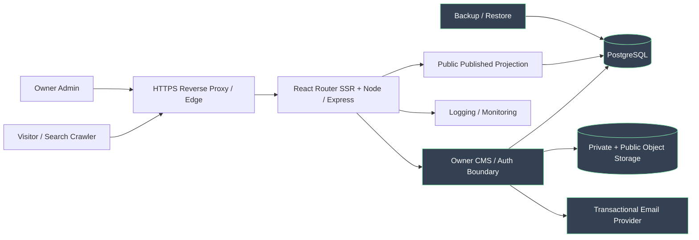
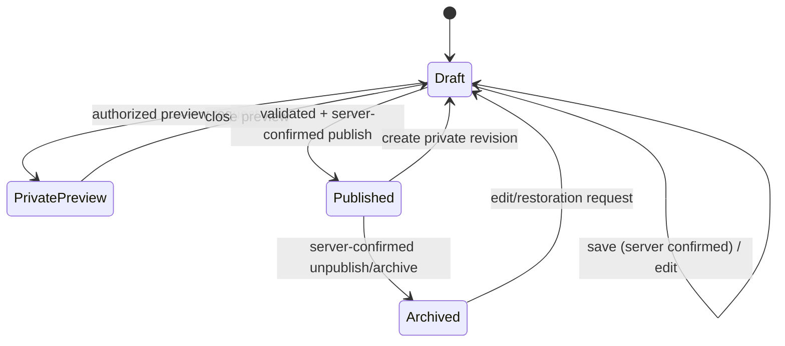

# Phase 03.0 — Candidate Architecture Context and Data Boundaries

**Status: DRAFT / DESIGN EXERCISE, NOT DEPLOYED.**

## Boundaries and security obligations
- **Internet → public SSR:** anonymous requests may receive only approved/published fields; enforce policy in route loader and service layer, not only in UI.
- **Admin → CMS:** full session established only after password and one-use email challenge; session cookie and CSRF policy; authorization on every mutation and private read.
- **CMS → DB:** publication/revision writes transactional; public projected query excludes drafts and private contact data.
- **CMS → media:** signature and file quotas; explicit asset ACL and published-use rules, avoid publicly accessible unapproved draft files.
- **Contact → email:** visitor message accepted/stored distinct from mail notification delivered.
- **SSR → SEO:** private previews noindex/no-store; published sitemap/canonical/redirects only; unpublish invalidates cache.
- **Operations → backup:** restore performed in isolated environment; backup includes asset references and access policies.

## Candidate publish state machine

**Note:** PrivatePreview is a **view action**, not necessarily a durable database publication state. The final state model is an ADR decision; this graph is illustrative.

## Threat-model starter table
| Threat | Assets impacted | Mitigation candidate | Evidence |
|---|---|---|---|
| Draft leak through SSR loader/API/cache | Private content | Central published-only query/service policy, authenticated preview | Anonymous negative integration |
| Session hijack or replay OTP | Owner account | HttpOnly secure cookie, expiry/revocation, OTP one-use and rate limits | Security E2E |
| CSRF/XSS in rich text | CMS integrity, visitors | CSRF checks, server validation, sanitization/CSP | Security integration |
| Malicious media upload | Storage and visitors | MIME signature and file-type guards, storage ACL, scanning decision | Upload negative tests |
| Contact spam and PII leak | Visitors | Rate limit, retention, minimization, admin-only inbox | Privacy/security review |
| Race between edit and publish | Content consistency | Transaction and revision precondition/optimistic concurrency | Conflict integration |

No internet/provider account, production environment or real running stack has been modified.
